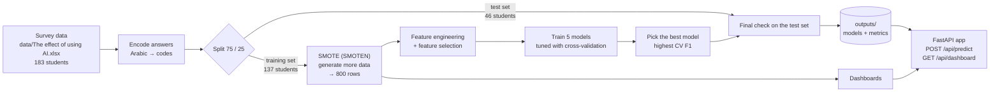

# Education Dropout Risk

This project predicts which university students are at risk of dropping out. It uses a survey
(in Arabic) of 183 students about how they use generative-AI text tools. The system:
- grows the training data with SMOTE
- engineers and selects features
- trains five models and keeps the best one
- serves interactive dashboards and a prediction API from a FastAPI web app

- [How the system is built](#how-the-system-is-built)
- [Run everything from zero](#run-everything-from-zero)
- [Results](#results)
- [Web app and API](#web-app-and-api-apppy)
- [Reference](#reference)

---

## How the system is built



The system runs in six stages. Each one is a module in `src/dropout_risk/`, and all of their
settings live in `config/config.yaml`.

### 1. Data (`data.py`)

The input is `data/The effect of using AI.xlsx` (sheet `Sheet1`): 183 students and 35 columns,
covering demographics, AI-usage habits, the perceived effects of AI and academic-integrity
experiences. The target is `Drop_Class_Label` (1 = drop, 0 = no drop). 50 of the 183 students
(27%) are in the drop class.

Encoding works like this:
- **Single-choice questions:** every Arabic answer is mapped to an integer code (for example
  "never → always" becomes 0 → 4).
- **The AI-tools question:** this multi-select becomes one yes/no flag per tool.
- **Free-text questions:** these become `gave_advice` and `learned_prompting`.
- **Unknown answers:** these stop the run with a clear error, so nothing is silently guessed.

Some columns are dropped:
- **`Drop_Risk_Score`:** the label is 1 exactly when this score is 5 or more, so using it would
  give away the answer.
- **Id and timestamps.**
- **Email:** it is always "anonymous".
- **Name:** it is empty.

The data is then split 75/25, stratified. The 46 test students are set aside and never touched
until the final check.

### 2. SMOTE: generating more data (`synthetic.py`)

The training set is small and imbalanced (100 no-drop vs 37 drop). **SMOTEN**, the version of
SMOTE for categorical data, generates new rows until each class has 400, for 800 in total.
Ordinary SMOTE would blend answer codes into values nobody could give, such as "2.4 on a 0–4
scale". SMOTEN builds each new row from the most common answers among similar students, so every
generated answer is a real option.

SMOTEN runs only on training data. It sits inside the model pipeline, so during cross-validation
it never sees the rows used for scoring.

### 3. Feature engineering and selection (`features.py`)

Nine summary indices are computed from the answers:
- `ai_dependency_index`
- `integrity_risk_count`
- `negative_impact_count`
- `ai_search_substitution`
- `perceived_benefit`
- `ai_literacy`
- `detection_awareness`
- `n_ai_tools`
- `is_senior`

Answers with no natural order (such as major) are one-hot encoded.

Features are then selected on the training data. Near-constant features are dropped, and the rest
are ranked by mutual information plus random-forest importance. Of each pair of near-duplicates,
only one is kept, and the **top 15** are used.

### 4. Train five models and pick the best (`models.py`, `main.py`)

**Logistic Regression, Decision Tree, Random Forest, CatBoost and XGBoost** each get a random
search over 20 settings, scored with 5-fold cross-validation repeated 3 times. The winner is the
model with the highest **cross-validated F1**. Near-ties go to the higher ROC-AUC, then to the
simpler model. Only then is each model scored once on the 46 held-out test students, with 95%
confidence intervals.

Everything is saved to `outputs/`: every model, the metrics, the report and the charts.

### 5. Dashboards

The dashboards present the training data at 800 rows (step 2). They use five tabs (Overview,
Jordan & universities, Student groups, How dropouts differ, Explore by topic), and can be filtered
by major, study year, gender and university type. The analytics code is in
`src/dropout_risk/dashboard/service.py`.

### 6. FastAPI app (`app.py`, `inference.py`, `web/`)

One web app serves everything:
- **`POST /api/predict`** takes a new student's answers. It processes them exactly like the
  training data and returns the Logistic Regression model's dropout probability, along with the
  factors behind it.
- **`GET /api/dashboard`** returns all dashboard data.
- **`/`** is the user interface, with a **Risk check** form and the **Dashboards**.

---

## Run everything from zero

These steps take a fresh clone to a running app in about 5 minutes. They work on Windows, macOS
and Linux.

### Prerequisites

- **Git**
- **[uv](https://docs.astral.sh/uv/getting-started/installation/)**, the Python package manager.
  You don't need to install Python yourself: uv downloads Python 3.12 automatically.

  ```powershell
  # Windows (PowerShell)
  powershell -ExecutionPolicy ByPass -c "irm https://astral.sh/uv/install.ps1 | iex"
  ```
  ```bash
  # macOS / Linux
  curl -LsSf https://astral.sh/uv/install.sh | sh
  ```

### Steps

```bash
# 1. Get the code
git clone <repository-url>
cd <repository-folder>          # the folder git just created

# 2. Install Python 3.12 and all dependencies into .venv/   (~1 min the first time)
uv sync

# 3. (optional) Generate the encoded and SMOTE datasets into data/processed/
#    The dashboards also create these automatically on first use.
uv run python scripts/generate_synthetic_data.py

# 4. Train and compare the five models  (~2 min)
#    Writes outputs/models/*.joblib, outputs/best_model.joblib, outputs/report.md, ...
uv run dropout-risk

# 5. (optional) Check that everything works: 27 tests
uv run pytest

# 6. Start the web app
uv run python app.py
```

Open **http://127.0.0.1:8000/**. The Risk check form opens first, and the **Dashboards** tab is
at the top. The interactive API documentation is at **http://127.0.0.1:8000/docs**.

> **Why step 4 is required:** trained models are not stored in the repository (`*.joblib` files
> are git-ignored). Until you train, `POST /api/predict` answers `503 … Train the models first`.
> Training is deterministic, so you get exactly the results shown below.

### Try the prediction API

You can fill in the form in the browser, or call the API directly. Every survey question is
required except `ai_tools`, `learned_prompting` and `advice`. The full list, with allowed answers,
is in `/docs`.

```powershell
# Windows PowerShell
$body = @{
  gender="Female"; major="Engineering & Tech"; degree="Bachelor"; study_year="4th year"
  residence="Capital"; university_type="Public"; ever_used_ai="Yes"
  ai_study_frequency="Always"; ai_replaces_research="Often"; analytical_skills_effect="Negative"
  independent_learning="Somewhat"; motivation_effect="Reduces"; over_reliance="Yes"
  ai_cheating_view="Depends on use"; submitted_full_project="Yes"; reviews_content="Sometimes"
  content_errors="Often"; used_ai_in_exam="No"; saves_time="Greatly"; flagged_by_professor="Yes"
  professor_was_right="Partly"; detector_knowledge="Average"; easy_to_detect="Sometimes"
  ai_improved_education="Somewhat"; ai_replaces_search_engines="Always"; ai_tools=@("ChatGPT")
} | ConvertTo-Json
Invoke-RestMethod -Method Post -Uri http://127.0.0.1:8000/api/predict -ContentType "application/json" -Body $body
```

```bash
# macOS / Linux
curl -X POST http://127.0.0.1:8000/api/predict -H "Content-Type: application/json" -d '{
  "gender": "Female", "major": "Engineering & Tech", "degree": "Bachelor", "study_year": "4th year",
  "residence": "Capital", "university_type": "Public", "ever_used_ai": "Yes",
  "ai_study_frequency": "Always", "ai_replaces_research": "Often", "analytical_skills_effect": "Negative",
  "independent_learning": "Somewhat", "motivation_effect": "Reduces", "over_reliance": "Yes",
  "ai_cheating_view": "Depends on use", "submitted_full_project": "Yes", "reviews_content": "Sometimes",
  "content_errors": "Often", "used_ai_in_exam": "No", "saves_time": "Greatly", "flagged_by_professor": "Yes",
  "professor_was_right": "Partly", "detector_knowledge": "Average", "easy_to_detect": "Sometimes",
  "ai_improved_education": "Somewhat", "ai_replaces_search_engines": "Always", "ai_tools": ["ChatGPT"]
}'
```

### Optional extras

```bash
uv run uvicorn app:app --reload --port 8000     # web app with auto-reload while editing code
uv run dropout-dashboard                        # the larger 10-dashboard version (see Reference)
uv run jupyter nbconvert --to notebook --execute --inplace notebooks/01_synthetic_data_smote.ipynb
```

### Troubleshooting

| Problem | Fix |
|---|---|
| `POST /api/predict` returns 503 | The models are not trained yet. Run `uv run dropout-risk`. |
| "address already in use" / port 8000 busy | Another server is running. Stop it, or use `uv run uvicorn app:app --port 8010`. |
| Windows: `uv run` fails with "failed to remove … .exe" | A server started with `uv run dropout-dashboard` or `dropout-risk` is still running. Stop it, or add `--no-sync`: `uv run --no-sync python app.py`. |
| Windows: Arabic text prints as `?` or crashes the console | Run `$env:PYTHONIOENCODING="utf-8"` first. |
| Charts don't appear | Hard-refresh the page (Ctrl+F5). Plotly is bundled in `web/vendor/`, so no internet is needed. |

---

## Results

The test set is 46 students, 13 of them in the drop class.

| Model | CV F1 | CV ROC-AUC | Test F1 (95% CI) | Test ROC-AUC | Test recall | Test precision |
|---|---|---|---|---|---|---|
| **Logistic Regression ★** | **0.927 ± 0.081** | 0.986 | 0.800 (0.59–0.95) | 0.958 | 0.769 | 0.833 |
| XGBoost | 0.922 ± 0.078 | 0.992 | 0.870 (0.67–1.00) | 0.998 | 0.769 | 1.000 |
| CatBoost | 0.900 ± 0.081 | 0.992 | 0.700 (0.40–0.90) | 0.984 | 0.538 | 1.000 |
| Random Forest | 0.855 ± 0.084 | 0.986 | 0.696 (0.42–0.88) | 0.950 | 0.615 | 0.800 |
| Decision Tree | 0.751 ± 0.134 | 0.837 | 0.560 (0.29–0.78) | 0.693 | 0.538 | 0.583 |

Always predicting "drop" scores a test F1 of 0.441, and every model beats that.

- **Best model: Logistic Regression.** It has the highest cross-validated F1, just ahead of
  XGBoost. XGBoost scored higher on the test set, but the test set isn't used for choosing, and with
  only 13 drop students the two confidence intervals overlap almost completely.
- **Strongest predictors:** these come from permutation importance on the test set:
  - AI's effect on analytical skills
  - its effect on study motivation
  - being flagged by a professor for AI use
  - over-reliance on AI
  - submitting a full AI-generated project
  - how often AI is used for study
  - using AI in an in-class exam
- **SMOTE note:** each generated answer is the most common one among similar students, so rare
  answers disappear. The 663 generated rows contain only 108 distinct patterns, so raising
  `samples_per_class` adds copies, not new information (see notebook §4).

The full report is `outputs/report.md`.

---

## Web app and API (`app.py`)

The app exposes two API endpoints.

| Endpoint | Purpose |
|---|---|
| `POST /api/predict` | Scores one student with the **Logistic Regression** model. |
| `GET /api/dashboard` | Returns all dashboard data. Optional filters: `major`, `study_year`, `gender`, `university_type` (answer codes). |

`POST /api/predict` returns:
- the probability, the prediction and the risk level (low / medium / high)
- the factors raising and lowering risk (each feature's contribution to the model's log-odds)
- the processed input that was sent to the model

**Input processing** (`src/dropout_risk/inference.py`) is identical to the training data's:
- **Single-choice answers** can be the English label (`"Often"`), the original Arabic answer
  (`"غالبًا"`) or the code (`3`). Case, whitespace and invisible characters are normalised.
- **`ai_tools`** is a list or a `;`-separated string.
- **`learned_prompting` and `advice`** are free text, parsed exactly like the survey's text.
- **Unknown fields, missing answers and invalid answers** return `422`, listing each problem field
  and its allowed answers.

The **Dashboards** tab has five views. Each one has its own link, for example
`/#/dashboards/jordan`.

| View | Shows |
|---|---|
| Overview | Headline numbers, warning signs and protective answers, dropout by university type and residence, major × year hot-spots |
| Jordan & universities | Students and dropout rate by university type and residence; public vs private scorecard; capital vs the governorates; four cross-heatmaps |
| Student groups | Dropout rate and an 11-indicator scorecard by major, study year, degree and gender |
| How dropouts differ | Index distributions and AI tool adoption, drop vs no-drop |
| Explore by topic | Dropout rate for every answer, per survey topic |

Scorecards hide groups with fewer than 10 students and say so.

---

## Reference

### Project layout

```
app.py                 web app (2 API endpoints + UI)
web/                   UI for app.py: index.html, styles.css, app.js, vendor/plotly
config/config.yaml     every setting: paths, split, SMOTE, feature selection, CV, dashboard
data/                  the survey (xlsx); data/processed/ is generated (git-ignored)
notebooks/             01_synthetic_data_smote.ipynb: builds and inspects the SMOTE data
scripts/               generate_synthetic_data.py
src/dropout_risk/      data.py · synthetic.py · features.py · models.py · evaluation.py · main.py
                       inference.py (prediction input processing) · dashboard/ (analytics + 10-dashboard app)
tests/                 pytest suite (27 tests)
outputs/               report, metrics, figures; models/*.joblib after training (git-ignored)
```

### Outputs of training

```
outputs/report.md                   full results, tables and figures
outputs/model_results.csv           CV + test metrics and best settings per model
outputs/feature_selection.csv       ranking and keep/drop reason for every feature
outputs/permutation_importance.csv
outputs/best_model.joblib           {"pipeline", "model", "selected_features", "base_features"}
outputs/models/<model>.joblib       all five tuned pipelines
outputs/figures/*.png
```

Each saved pipeline expects the 32 **encoded** survey answers (`data.encode_survey`). SMOTEN runs
only while training; at prediction time the pipeline engineers features, selects them and predicts.

### The 10-dashboard package (`uv run dropout-dashboard`)

A larger set of dashboards lives in `src/dropout_risk/dashboard/`, served at
`http://127.0.0.1:8000/dashboards/`:
- Executive overview
- Risk drivers
- Student segments
- AI usage & literacy
- Learning impact
- Academic integrity
- Early-warning watchlist
- Risk simulator
- Model performance
- Synthetic data quality

Every page can switch between the SMOTE-augmented data, only the generated rows, or the original
183 students.

To add it to another FastAPI app:

```python
from fastapi import FastAPI
from dropout_risk.dashboard import include_dashboards

app = FastAPI()
service = include_dashboards(app, api_prefix="/api/dropout", ui_prefix="/dashboards")
```

Its API supports `source=augmented|synthetic|original` and segment filters
`f=<question>:<code>`:

| Endpoint | Returns |
|---|---|
| `GET /meta` | data dictionary: questions, answer labels, groups, sources, risk bands |
| `GET /kpis` | row counts, drop share, top risk signal, index means by class |
| `GET /breakdown/{question}` · `GET /breakdowns?group=` | drop share, count and lift per answer |
| `GET /profile/{question}` | answer distribution of drop vs no-drop students |
| `GET /crosstab?row=&col=` | drop-share matrix for two questions |
| `GET /tools` | AI tool adoption by class |
| `GET /risk-signals` | all answers ranked by lift (`limit`, `min_n`) |
| `GET /watchlist` | scored surveyed students (`band`, `limit`) |
| `POST /predict` | `{"answers": {"over_reliance": 2, ...}}` → probability, band, what would reduce risk |
| `GET /model/performance` · `GET /model/importance` | metrics, ROC, confusion matrices; permutation importance |
| `GET /data-quality` · `GET /data-quality/{question}` | real vs generated comparison |
| `GET /dataset?format=csv\|json&decoded=true` | raw rows for Power BI / Tableau / Excel |
