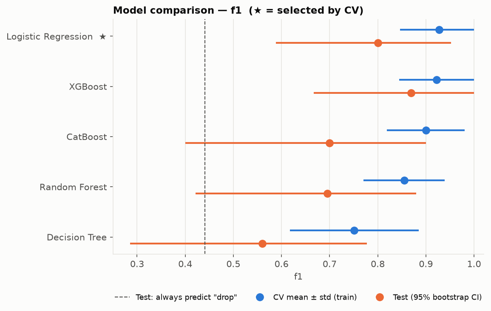
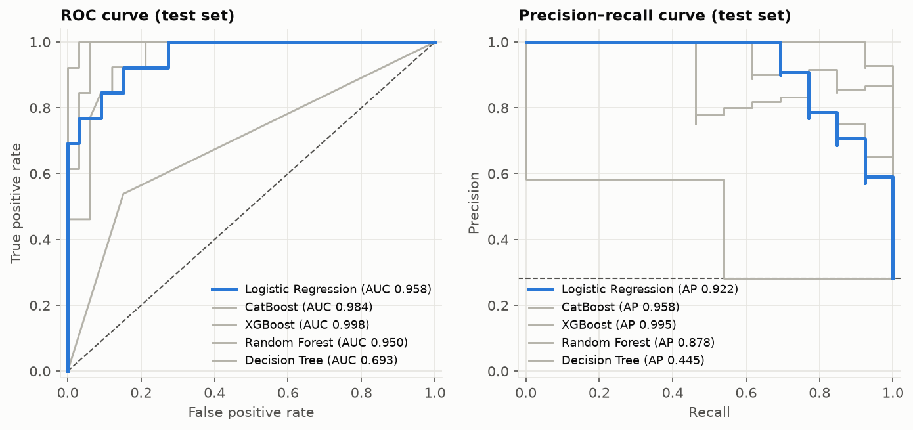
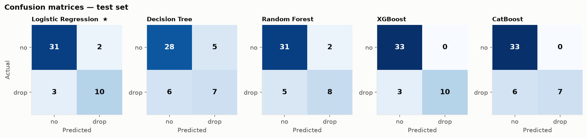
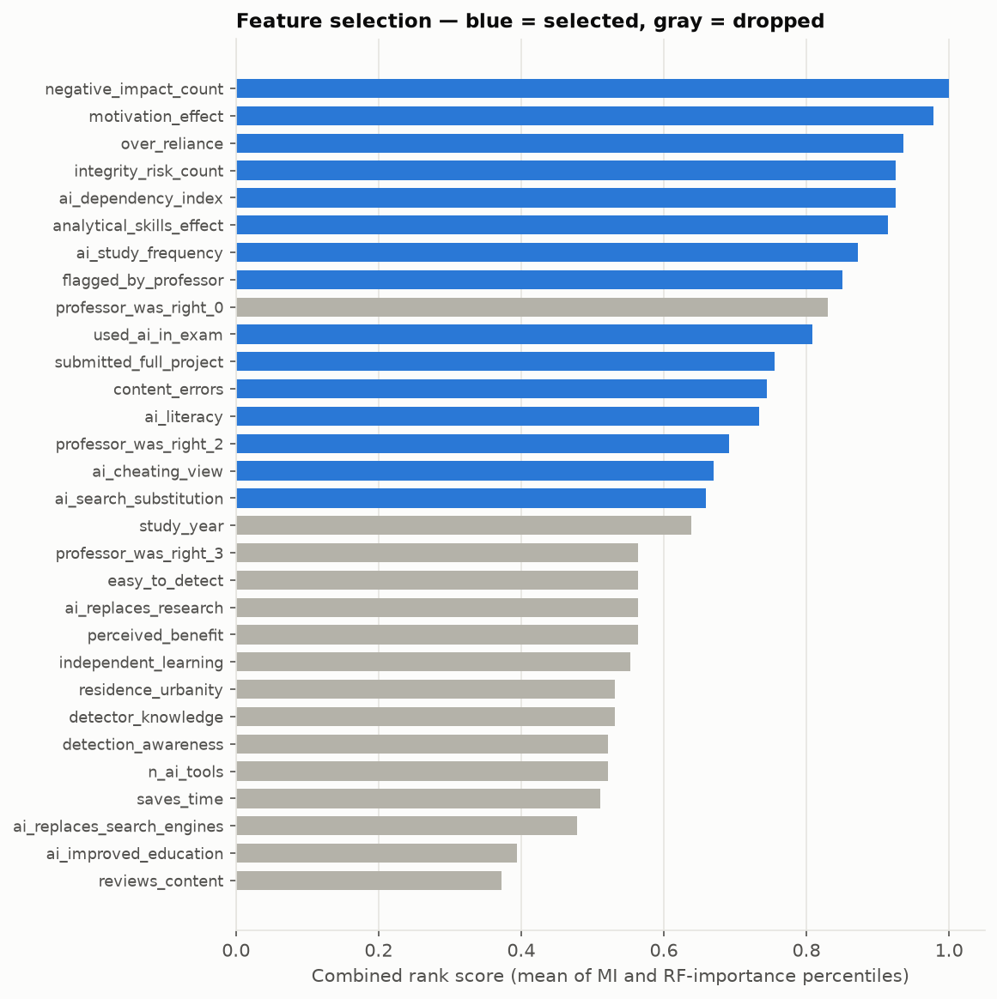
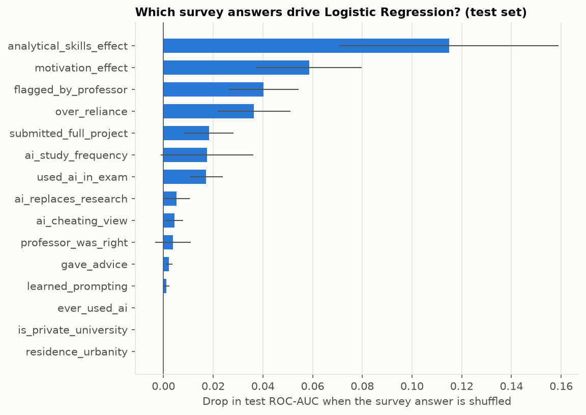

# Dropout risk — model report

- Base features: 32 survey answers → 50 after feature engineering → **15 selected**
- Train: 137 respondents (37 drop), oversampled with SMOTEN to
  400 per class inside every CV fold and for the final fit
- Test: 46 held-out respondents, never resampled (13 drop)
- Tuning: random search, 20 candidates/model, 5-fold CV
  × 3 repeats; selection by CV f1 (test set not used for selection)

## Best model: Logistic Regression

CV f1 **0.927 ± 0.081**, test f1 **0.800**
(95% CI 0.59–0.95), test ROC-AUC 0.958.
Hyper-parameters: `{"C": 56.69849511478853}`

## All models

| Model | CV f1 | CV ROC-AUC | Test f1 (95% CI) | Test ROC-AUC | Test recall | Test precision | Test accuracy |
|---|---|---|---|---|---|---|---|
| Logistic Regression ★ | 0.927 ± 0.081 | 0.986 ± 0.028 | 0.800 (0.59–0.95) | 0.958 | 0.769 | 0.833 | 0.891 |
| XGBoost | 0.922 ± 0.078 | 0.992 ± 0.012 | 0.870 (0.67–1.00) | 0.998 | 0.769 | 1.000 | 0.935 |
| CatBoost | 0.900 ± 0.081 | 0.992 ± 0.014 | 0.700 (0.40–0.90) | 0.984 | 0.538 | 1.000 | 0.870 |
| Random Forest | 0.855 ± 0.084 | 0.986 ± 0.017 | 0.696 (0.42–0.88) | 0.950 | 0.615 | 0.800 | 0.848 |
| Decision Tree | 0.751 ± 0.134 | 0.837 ± 0.089 | 0.560 (0.29–0.78) | 0.693 | 0.538 | 0.583 | 0.761 |

Trivial baseline on the same test set, always predicting "drop": f1 0.441,
recall 1.000, precision 0.283, ROC-AUC 0.500. A model that doesn't beat this
has learned nothing useful.

## Selected features

| feature | mutual_info | rf_importance | score |
|---|---|---|---|
| negative_impact_count | 0.221 | 0.142 | 1.000 |
| motivation_effect | 0.181 | 0.111 | 0.979 |
| over_reliance | 0.108 | 0.074 | 0.936 |
| integrity_risk_count | 0.116 | 0.065 | 0.926 |
| ai_dependency_index | 0.122 | 0.055 | 0.926 |
| analytical_skills_effect | 0.095 | 0.067 | 0.915 |
| ai_study_frequency | 0.094 | 0.054 | 0.872 |
| flagged_by_professor | 0.078 | 0.039 | 0.851 |
| used_ai_in_exam | 0.047 | 0.019 | 0.809 |
| submitted_full_project | 0.042 | 0.018 | 0.755 |
| content_errors | 0.033 | 0.018 | 0.745 |
| ai_literacy | 0.021 | 0.018 | 0.734 |
| professor_was_right_2 | 0.036 | 0.015 | 0.691 |
| ai_cheating_view | 0.017 | 0.018 | 0.670 |
| ai_search_substitution | 0.020 | 0.015 | 0.660 |

## What drives the best model (permutation importance on the test set)

| survey answer | mean | std |
|---|---|---|
| analytical_skills_effect | 0.115 | 0.044 |
| motivation_effect | 0.059 | 0.021 |
| flagged_by_professor | 0.040 | 0.014 |
| over_reliance | 0.036 | 0.015 |
| submitted_full_project | 0.018 | 0.010 |
| ai_study_frequency | 0.018 | 0.019 |
| used_ai_in_exam | 0.017 | 0.007 |
| ai_replaces_research | 0.005 | 0.005 |
| ai_cheating_view | 0.004 | 0.003 |
| professor_was_right | 0.004 | 0.007 |

